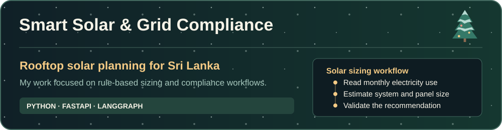
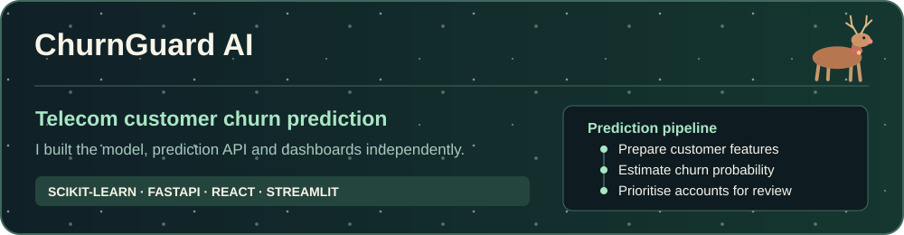
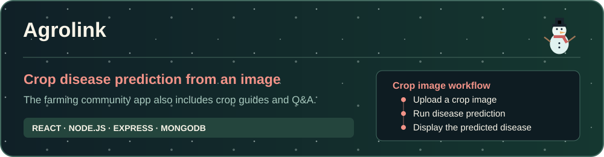
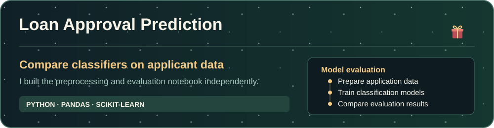
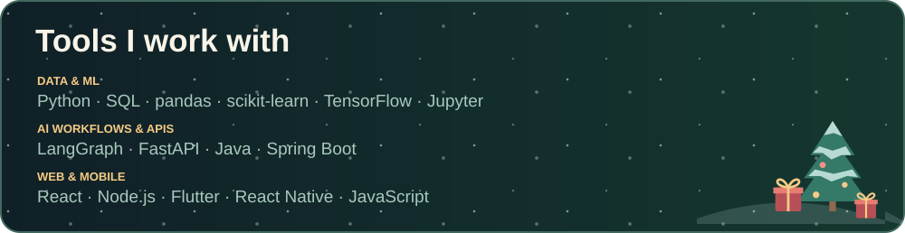

<h1>Vishwa Nethsara</h1>

<strong>AI undergraduate · Full-stack developer · Sri Lanka</strong>

❄️ Merry Christmas & Happy Holidays 🎄

## Selected projects

 <a href="https://churnguard-ai-theta.vercel.app/">Try the live ChurnGuard demo →</a>

<a href="https://github.com/Vishwa633?tab=repositories">Explore all repositories →</a>

  
  
  

Top languages and GitHub trophies

 

  
  
  

