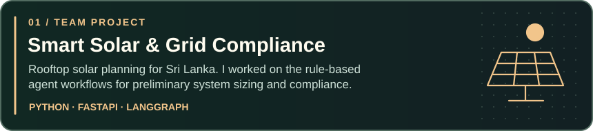
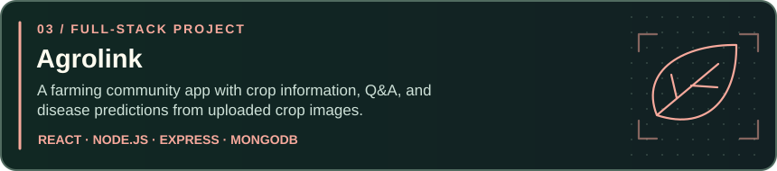

<h1>Vishwa Nethsara</h1>

<strong>AI undergraduate · Full-stack developer · Sri Lanka</strong>

❄️ December edition · Happy holidays from Sri Lanka! 🎄

## About me

I'm an IT undergraduate specialising in AI in Sri Lanka. I build machine learning projects and the interfaces people use to interact with them. I'm currently learning Java and Spring Boot alongside AI/ML. Ask me about Java or machine learning.

## Selected projects

  <a href="https://churnguard-ai-theta.vercel.app/">Open ChurnGuard live demo →</a>

<a href="https://github.com/Vishwa633?tab=repositories">Explore all repositories →</a>

## Languages, frameworks & tools

   
  

## GitHub activity

  
  
   
  

GitHub trophies

 

  

